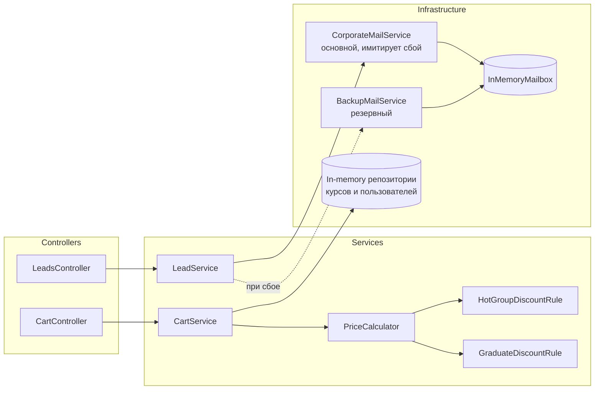
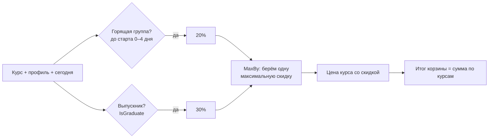
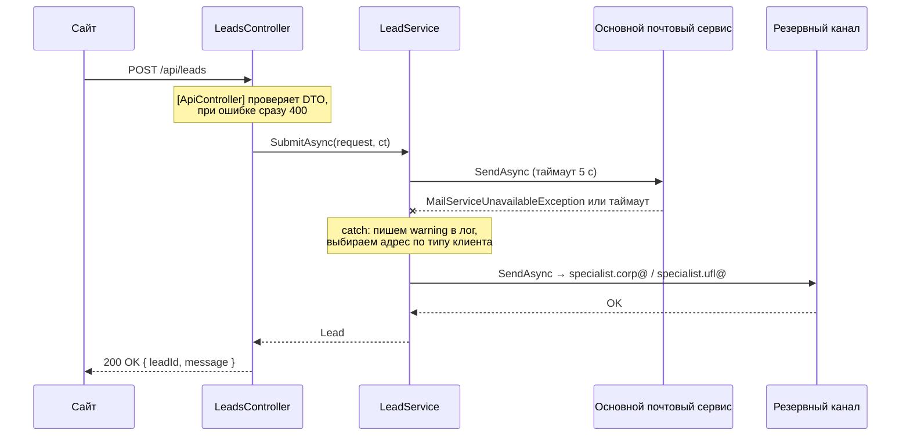

# Учебный центр: скидки и отказоустойчивая форма заявок

Тестовое задание на ASP.NET Core Web API (.NET 8). Данные хранятся в памяти, база данных и Docker не нужны.

| Требование ТЗ | Где в коде |
|---|---|
| Расчёт стоимости корзины, скидки 20% / 30%, без суммирования | [`PriceCalculator`](src/TrainingCenter.Api/Services/Pricing/PriceCalculator.cs), правила в [`Services/Pricing`](src/TrainingCenter.Api/Services/Pricing) |
| `POST /api/leads` с переключением на резервный email при сбое | [`LeadsController`](src/TrainingCenter.Api/Controllers/LeadsController.cs) → [`LeadService`](src/TrainingCenter.Api/Services/Leads/LeadService.cs) |
| Имитация сбоя основного почтового сервиса | [`CorporateMailService`](src/TrainingCenter.Api/Infrastructure/Mail/CorporateMailService.cs) |
| async/await, разделение контроллера и сервисов через DI | [`DependencyInjection.cs`](src/TrainingCenter.Api/DependencyInjection.cs) |
| Валидация (email, телефон) | [`LeadRequest`](src/TrainingCenter.Api/Contracts/LeadRequest.cs) |
| Unit-тесты на xUnit | [`tests/TrainingCenter.Tests`](tests/TrainingCenter.Tests): 17 тестов, все проходят |

---

## Быстрый старт

Нужен .NET SDK 8 или новее.

```bash
dotnet test
```

```bash
dotnet run --project src/TrainingCenter.Api --launch-profile http
```

После запуска:

- Swagger UI: http://localhost:5080/swagger
- Готовые запросы для VS / Rider / VS Code (REST Client): [`TrainingCenter.Api.http`](src/TrainingCenter.Api/TrainingCenter.Api.http)

По умолчанию основной почтовый сервис «на техработах» (`CorporateMail:SimulateOutage = true`), то есть каждая заявка уходит через резервный канал. Чтобы проверить штатный режим, сбой можно выключить:

```bash
dotnet run --project src/TrainingCenter.Api --launch-profile http -- --CorporateMail:SimulateOutage=false
```

### Эндпоинты

| Метод | Путь | Назначение |
|---|---|---|
| `POST` | `/api/leads` | **Задача 2.** Форма «Обратный звонок» |
| `POST` | `/api/cart/price` | Расчёт корзины (задача 1), добавлен для демонстрации |
| `GET` | `/api/courses` | Каталог курсов с датами старта |
| `GET` | `/api/debug/mailbox` | Только в Development: какие письма ушли, через какой канал и на какой адрес |

---

## Архитектура



```
src/TrainingCenter.Api/
├── Controllers/         тонкие контроллеры: принимают запрос и вызывают сервис
├── Contracts/           DTO запросов и ответов с атрибутами валидации
├── Domain/              Course, UserProfile, Lead, ClientType
├── Services/
│   ├── Pricing/         правила скидок, PriceCalculator, CartService
│   └── Leads/           LeadService (fallback-логика), LeadRoutingOptions
├── Infrastructure/
│   ├── Mail/            основной и резервный почтовые сервисы, InMemoryMailbox
│   └── Data/            in-memory репозитории (mock вместо БД)
├── DependencyInjection.cs   регистрация сервисов в DI (AddPricing / AddLeads)
└── Program.cs
tests/TrainingCenter.Tests/
├── Pricing/PriceCalculatorTests.cs   unit-тесты скидок
├── Leads/LeadServiceTests.cs         unit-тесты fallback (Moq)
└── Api/LeadsEndpointTests.cs         интеграционные тесты HTTP-эндпоинта (WebApplicationFactory)
```

**Основные принципы:**

- **Контроллеры тонкие.** Валидацию выполняет `[ApiController]`: при невалидном DTO он сам возвращает 400 ещё до вызова action. Бизнес-логика находится в сервисах.
- **Все зависимости объявлены через интерфейсы и передаются через DI.** Поэтому сервисы тестируются без HTTP и без реальной почты.
- **async/await используется там, где есть I/O**: репозитории, отправка почты, контроллеры. Через всю цепочку передаётся `CancellationToken`.
- **Время абстрагировано через `TimeProvider`** (.NET 8). Тесты фиксируют «сегодня» и не зависят от реальной даты.
- **Настройки вынесены в `appsettings.json`**: адреса получателей, таймаут и флаг имитации сбоя. Конфигурация проверяется при старте (`ValidateOnStart`).

Время жизни сервисов: правила скидок, калькулятор, репозитории и `InMemoryMailbox` зарегистрированы как Singleton, потому что они не хранят состояния запроса. Почтовые сервисы, `LeadService` и `CartService` зарегистрированы как Scoped, на время одного HTTP-запроса. Singleton-сервисы не зависят от Scoped, так что проблемы captive dependency нет.

---

## Задача 1. Расчёт скидок



**Как устроено:**

- Каждая скидка оформлена отдельным классом-правилом с интерфейсом [`IDiscountRule`](src/TrainingCenter.Api/Services/Pricing/IDiscountRule.cs) (паттерн «Стратегия»). Правило возвращает `Discount`, если подходит к курсу, или `null`, если нет.
- [`PriceCalculator`](src/TrainingCenter.Api/Services/Pricing/PriceCalculator.cs) получает из DI все правила (`IEnumerable<IDiscountRule>`). Для каждого курса он выбирает одну максимальную скидку (`MaxBy`), поэтому скидки не суммируются.
- Чтобы добавить новую акцию, достаточно написать новый класс и зарегистрировать его одной строкой. Калькулятор при этом не меняется (принцип открытости/закрытости).
- Деньги считаются в `decimal`. Сумма скидки округляется до копеек (`MidpointRounding.AwayFromZero`).
- Калькулятор **синхронный**: он только считает и не делает I/O. Асинхронно работает [`CartService`](src/TrainingCenter.Api/Services/Pricing/CartService.cs): он загружает профиль и курсы из репозиториев и передаёт их в калькулятор.

**Как трактуются условия ТЗ:**

| Ситуация | Результат |
|---|---|
| До старта 0–4 дня (включая день старта) | «Горящая группа», 20% |
| До старта ровно 5 дней и больше | Нет скидки: условие «менее 5 дней» не выполнено |
| Курс уже стартовал | Нет скидки: горящей считается только группа, которая ещё не началась |
| Выпускник и горящая группа одновременно | 30%, а не 50%: выбирается максимальная скидка |
| Скидка выбирается… | …для каждого курса отдельно: в одной корзине курсы могут получить разные скидки |

Флаг `IsGraduate` берётся из профиля пользователя на сервере, а не из запроса. Иначе любой клиент мог бы сам указать, что он выпускник, и получить скидку.

**Пример** (`POST /api/cart/price`, курсы 1–4, базовая сумма 138 000 ₽):

| Курс | Старт через | Обычный пользователь | Выпускник |
|---|---|---|---|
| C# для начинающих, 30 000 | 3 дня | −20% → 24 000 | −30% → 21 000 |
| ASP.NET Core Web API, 45 000 | 14 дней | 45 000 | −30% → 31 500 |
| Docker и Kubernetes, 38 000 | 1 день | −20% → 30 400 | −30% → 26 600 |
| SQL для аналитиков, 25 000 | 5 дней | 25 000 (граница) | −30% → 17 500 |
| **Итого** | | **124 400** | **96 600** |

---

## Задача 2. Отказоустойчивый `POST /api/leads`



**Как устроено:**

- [`CorporateMailService`](src/TrainingCenter.Api/Infrastructure/Mail/CorporateMailService.cs) изображает корпоративный SMTP. Пока включён флаг `CorporateMail:SimulateOutage`, он бросает `MailServiceUnavailableException`.
- [`LeadService`](src/TrainingCenter.Api/Services/Leads/LeadService.cs) сначала отправляет заявку через основной сервис. Если тот падает, сервис перехватывает исключение, пишет warning в лог и переотправляет заявку через [`BackupMailService`](src/TrainingCenter.Api/Infrastructure/Mail/BackupMailService.cs):
  - юридическое лицо → `specialist.corp@yandex.ru`;
  - физическое лицо → `specialist.ufl@yandex.ru`.
- Клиент в любом случае получает `200 OK` с `leadId`. По ответу нельзя понять, через какой канал ушло письмо.
- Адреса не зашиты в код, они лежат в `appsettings.json` (секция `LeadRouting`).

**Почему перехват сделан в сервисе, а не в теле контроллера.** В ТЗ сказано, что ошибку перехватывает контроллер. Но одновременно оценивается разделение контроллера и сервисного слоя. Поэтому выбор канала и fallback — это бизнес-логика `LeadService`, а контроллер остаётся тонким. Для клиента результат такой, как требует ТЗ: эндпоинт сам перехватывает сбой и возвращает 200. Такую логику проще покрыть тестами без HTTP, и её можно переиспользовать (например, из фоновой задачи).

**Дополнительные меры, которых нет в ТЗ:**

- **Таймаут на основной сервис** (`LeadRouting:PrimaryTimeout`). Почтовый сервер может не упасть, а зависнуть. Тогда через 5 секунд заявка уйдёт в резервный канал, и клиенту не придётся ждать бесконечно.
- **Отмена запроса клиентом не запускает fallback.** Это обеспечивает фильтр `catch (Exception) when (!ct.IsCancellationRequested)`. Если пользователь закрыл страницу, резервное письмо не отправляется.
- **Если упал и резервный канал**, исключение доходит до `UseExceptionHandler`, и клиент получает `500 ProblemDetails` без stack trace. Ответ 200 в такой ситуации означал бы, что мы молча потеряли заявку.
- **Персональные данные клиента (телефон, email) в лог не пишутся.** В логе только ID заявки и адрес получателя.

---

## Валидация

[`LeadRequest`](src/TrainingCenter.Api/Contracts/LeadRequest.cs) проверяется атрибутами DataAnnotations. Благодаря `[ApiController]` при ошибке автоматически возвращается `400 ValidationProblemDetails` с перечнем полей.

| Поле | Правило |
|---|---|
| `name` | обязательно, до 100 символов |
| `phone` | обязательно, 10–15 цифр; допускаются `+`, пробелы, дефисы и скобки (`+7 (999) 123-45-67`) |
| `email` | обязательно, формат `x@domain.tld`, до 254 символов. Стандартный `[EmailAddress]` пропускает `user@localhost`, поэтому вместо него используется регулярное выражение |
| `clientType` | обязательно, `Individual` (физ. лицо) или `LegalEntity` (юр. лицо) |

`ClientType` объявлен как nullable (`ClientType?`), а значения enum начинаются с 1. Без этого `[Required]` пропустил бы непереданное поле: оно получило бы значение по умолчанию 0.

Пример ответа на невалидный запрос:

```json
{
  "status": 400,
  "title": "One or more validation errors occurred.",
  "errors": {
    "Email": ["Некорректный email"],
    "Phone": ["Укажите телефон"]
  }
}
```

---

## Тесты

```bash
dotnet test
```

Всего 17 тестов (xUnit + Moq + `WebApplicationFactory`), все проходят.

| Тест | Что проверяет |
|---|---|
| `PriceCalculatorTests.HotGroupDiscount_DependsOnDaysUntilStart` | границы «горящей группы»: 0 и 4 дня дают 20%; 5 дней, 30 дней и уже стартовавший курс дают 0% |
| `PriceCalculatorTests.GraduateOnHotCourse_GetsOnlyMaxDiscount_DiscountsAreNotSummed` | главное бизнес-правило: 30%, а не 50% |
| `PriceCalculatorTests.Cart_EachCourseGetsItsOwnDiscount_AndTotalsAreSummed` | итоговые суммы корзины |
| `LeadServiceTests.SubmitAsync_PrimaryWorks_BackupIsNotUsed` | в штатном режиме резервный канал не вызывается |
| `LeadServiceTests.SubmitAsync_PrimaryThrows_LeadIsRedirectedToBackupByClientType` | при сбое письмо уходит на правильный адрес для юр. и физ. лица |
| `LeadServiceTests.SubmitAsync_PrimaryHangs_FallsBackAfterTimeout` | если основной сервис завис, срабатывает таймаут и fallback |
| `LeadServiceTests.SubmitAsync_ClientCancelledRequest_DoesNotFallBack` | при отмене запроса клиентом резервное письмо не отправляется |
| `LeadsEndpointTests.PostLead_WhenPrimaryMailIsDown_Returns200_AndLeadGoesToBackupAddress` | по HTTP: клиент получает 200, письмо уходит на `specialist.corp@yandex.ru` |
| `LeadsEndpointTests.PostLead_InvalidInput_Returns400WithFieldError` | по HTTP: невалидный email или телефон дают 400 с указанием поля |

---

## Что бы я добавил в продакшене

- **Transactional Outbox.** Сохранять заявку в БД, а отправку выполнять фоновым воркером с повторными попытками. Тогда заявка не потеряется, даже если недоступны оба канала.
- **Polly / `Microsoft.Extensions.Http.Resilience`.** Retry с экспоненциальной задержкой и circuit breaker. Пока основной сервер на техработах, не нужно ждать таймаут на каждой заявке: размыкатель сразу направит их в резервный канал.
- **Защита формы от спама:** rate limiting (`AddRateLimiter`) и капча.
- **Скидки в конфигурации или БД.** Проценты и пороги вынести в настройки, чтобы маркетинг менял их без релиза.
- **Профиль пользователя из аутентификации** (claims), а не по `userId` из запроса.
- **Явная таймзона учебного центра** для расчёта «до старта осталось N дней». Сейчас используется локальное время сервера.
